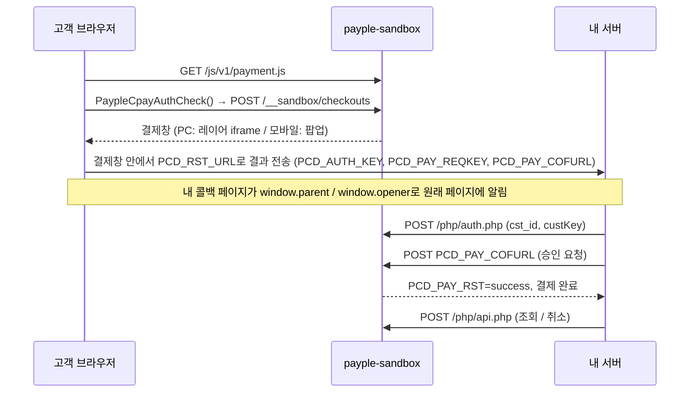

<div align="center">

# payple-sandbox

**[페이플](https://www.payple.kr) 앱카드 결제를 내 컴퓨터에서 그대로 흉내 내는 테스트 서버**

결제, 거절, 부분 환불, 승인 지연까지 페이플 계정도, 도메인 등록도, 실제 돈도 없이 끝까지 돌려볼 수 있어요.
개발자, E2E 테스트, AI 에이전트 모두 쓸 수 있어요.

[](https://github.com/PeraSite/payple-sandbox/actions/workflows/ci.yml)
[](LICENSE)
[](https://bun.sh)
[](tsconfig.json)
[](package.json)

[빠른 시작](#빠른-시작) · [제어 API](#제어-api) · [시나리오](#시나리오) · [라이브러리로 쓰기](#라이브러리로-쓰기)

</div>

---

## 왜 만들었나요

페이플 TEST 환경은 실제 연동을 확인하기엔 좋지만, 매일 개발하면서 쓰기엔 불편해요.

- 결제를 여는 사이트 주소를 미리 등록해야 해서, 미리보기 주소나 `localhost`에서는 `AUTH0007` 오류가 나요.
- 테스트할 때마다 누군가 카드 결제창을 직접 눌러야 해요.
- 콜백 유실, 승인 응답 지연, 금액 불일치, 취소 실패 같은 실패 상황은 원할 때 만들기가 거의 불가능해요.
- TEST 환경은 전체 환불만 돼서 부분 환불 로직을 확인할 수 없어요.

`payple-sandbox`는 페이플과 같은 방식으로 요청을 주고받고, 상황을 마음대로 바꿀 수 있는 작은 제어 API를 더했어요. 사람이든 Playwright든 코딩 에이전트든 모든 경우를 매번 똑같이 재현할 수 있어요.

> [!IMPORTANT]
> 개인이 만든 비공식 테스트 도구이며 **페이플과 관계가 없어요.** 실서비스에 붙이기 전에는 반드시 페이플 TEST 환경에서도 확인하세요.

## 기능

- 🧾 **페이플과 같은 요청 형식**: 가맹점 인증(`/php/auth.php`), CERT 승인 요청, 단건·목록 조회, 누적 부분 취소(`/php/api.php`)
- 🪟 **실제와 같은 결제창 방식**: 실제 페이플 스크립트처럼 PC에서는 화면 위 레이어(iframe `cpay_ifr`), 모바일에서는 팝업 창으로 결제창을 열고, 그 안에서 결과를 `PCD_RST_URL`로 보내요. 팝업이 막히면 페이플과 같은 안내창이 떠요.
- 🤖 **에이전트 친화적**: 결제창 자동 승인, 브라우저 없이 결과 전송, 콜백 없이 결제만 완료시키기. 모든 버튼에 `data-testid`가 있어요.
- 💥 **장애 재현**: 승인 응답 지연(돈은 빠져나갔는데 응답이 끊김), 금액 불일치, 승인 거절, 조회 서버 오류, 취소 실패, 결제창 스크립트 장애
- 💾 **상태 저장**: JSON 파일에 결제 기록을 남겨서, 서버를 껐다 켜도 환불할 수 있어요.
- 📦 **의존성 0개**: Bun 프로세스 하나로 돌아가고, 테스트 코드 안에서 `fetch` 핸들러로 바로 쓸 수도 있어요.

## 빠른 시작

```sh
bunx github:PeraSite/payple-sandbox --app-origin http://localhost:3000
```

저장소를 받아서 실행:

```sh
git clone https://github.com/PeraSite/payple-sandbox && cd payple-sandbox
bun install
bun start -- --app-origin http://localhost:3000 --state .state/payple.json
```

Docker로 실행:

```sh
docker build -t payple-sandbox https://github.com/PeraSite/payple-sandbox.git
docker run --rm -p 9444:9444 payple-sandbox --app-origin http://localhost:3000
```

켜지면 내 서비스에 넣을 설정값을 보여줘요.

```text
가맹점 설정값:
  cst_id          sandbox
  custKey         sandbox-cust-key
  clientKey       sandbox-client-key
  refundKey       sandbox-refund-key
  API 주소        http://localhost:9444
  승인 요청 주소  http://localhost:9444/api/v1/payments/cards/approval/confirm
  결제창 스크립트 http://localhost:9444/js/v1/payment.js
```

내 서비스의 페이플 API 주소, 승인 요청 주소, 결제창 스크립트 주소만 샌드박스로 바꾸면 돼요. 코드는 고칠 필요 없어요. 결제 버튼 하나짜리 예제는 [`examples/checkout.html`](examples/checkout.html)에 있어요.

> [!TIP]
> 서비스가 HTTPS 주소만 받는다면 샌드박스 앞에 TLS를 붙여 주세요(Caddy, `tailscale serve`, ngrok, [portless](https://github.com/vercel-labs/portless) 등). 그 공개 주소를 `--origin`으로 넘기거나, `--tls-cert`·`--tls-key`로 직접 HTTPS를 켤 수 있어요.

### 옵션

| 옵션 | 환경 변수 | 기본값 |
| --- | --- | --- |
| `-p, --port` | `PAYPLE_SANDBOX_PORT` | `9444` |
| `-o, --origin` | `PAYPLE_SANDBOX_ORIGIN` | `http://localhost:<포트>` |
| `-a, --app-origin` (여러 번 가능) | `PAYPLE_SANDBOX_APP_ORIGINS` (쉼표로 구분) | `http://localhost:3000` |
| `-s, --state` | `PAYPLE_SANDBOX_STATE_FILE` | 메모리에만 저장 |
| `--cst-id` · `--cust-key` · `--client-key` · `--refund-key` | `PAYPLE_SANDBOX_CST_ID` · `…_CUST_KEY` · `…_CLIENT_KEY` · `…_REFUND_KEY` | 위의 샌드박스 값 |
| `--tls-cert` · `--tls-key` | | HTTP |

## 결제 흐름



## 제어 API

제어용 주소는 모두 `/__sandbox` 아래에 있고 JSON을 받아요.

| 요청 | 하는 일 |
| --- | --- |
| `GET /__sandbox/state` | 결제 목록(`pending` 대기 · `paid` 결제됨 · `declined` 거절 · `closed` 창 닫음, 금액, 남은 금액)과 현재 시나리오 |
| `POST /__sandbox/scenario` | 시나리오 값 바꾸기 (모르는 키는 무시) |
| `POST /__sandbox/reset` | 결제 기록과 시나리오 초기화 |
| `POST /__sandbox/payments/:oid/complete` | 결제창이 하는 것과 똑같이 결제 결과를 내 서버로 보내요. 본문: `{"result":"approve"\|"decline"\|"close"}`. 브라우저에서 연 적 없는 주문이면 `total`과 `callbackUrl`도 넘겨 주세요. |
| `POST /__sandbox/payments/:oid/capture` | 결과를 보내지 **않고** 결제만 완료시켜요. 고객이 결제 후 바로 창을 닫은 상황이에요. |

```sh
# 결제창이 알아서 승인되게 하고 브라우저 테스트 실행
curl -X POST localhost:9444/__sandbox/scenario -d '{"autoComplete":"approve"}'

# 다음 승인은 돈은 빠져나가지만 응답이 늦게 와요
curl -X POST localhost:9444/__sandbox/scenario -d '{"approvalConfirm":"timeout"}'

# 페이플 쪽에서는 어떻게 기록됐는지 보기
curl localhost:9444/__sandbox/state
```

결제창은 PC에서는 `#cpay_ifr` iframe 안에, 모바일에서는 팝업 창에 있어요. 버튼 test ID는 `payple-sandbox-approve`(결제), `payple-sandbox-decline`(카드사 거절), `payple-sandbox-close`(창 닫기)예요.

## 시나리오

| 항목 | 값 | 재현하는 상황 |
| --- | --- | --- |
| `autoComplete` | `null` · `approve` · `decline` · `close` | 결제창을 띄울지, 바로 결과를 낼지 |
| `approvalConfirm` | `ok` · `reject` · `timeout` · `amount_mismatch` · `server_error` | 카드 승인 결과. `timeout`은 결제는 되고 12초 뒤에 응답해요 |
| `lookup` | `ok` · `server_error` | 결제 조회 서버 상태 |
| `cancel` | `ok` · `reject` · `timeout` | 환불 결과. `timeout`은 환불은 되고 늦게 응답해요 |
| `checkoutScript` | `ok` · `unavailable` | `/js/v1/payment.js`가 503 오류 |

취소 금액은 실제 페이플처럼 쌓여요. 목록 조회 상태가 `결제완료` → `부분승인취소완료` → `승인취소완료`로 바뀌고 남은 금액도 함께 나와요. 남은 금액보다 많이 환불하려고 하면 거절돼요.

## 라이브러리로 쓰기

`createPaypleSandbox()`는 표준 `fetch` 핸들러를 돌려줘요. 포트나 네트워크 없이 단위 테스트 안에서 바로 쓸 수 있어요.

```ts
import { createPaypleSandbox } from "payple-sandbox";

const sandbox = createPaypleSandbox({
  origin: "https://payple.test",
  appOrigins: ["https://shop.test"],
  credentials: { cstId: "shop", custKey: "cust", clientKey: "client", refundKey: "refund" },
  fetch: myCallbackHandler,  // 결제 결과(CERT 콜백)를 받는 함수
  timeoutDelayMs: 50,        // 테스트에서 timeout 시나리오를 빨리 끝내기
});

const paypleClient = createMyPaypleClient({
  baseUrl: "https://payple.test",
  fetch: (input, init) => sandbox.handle(new Request(input, init)),
});
```

직접 서버로 띄워도 돼요: `Bun.serve({ fetch: sandbox.handle })`

## 지원 범위

지원: 국내 앱카드 **CERT** 결제(가맹점이 승인 요청을 보내는 일반 카드 결제).
아직 미지원: 빌링키 / `PUSERINFO`, 간편결제 `PAYM`, 계좌이체, 해외카드, 웹훅, 현금영수증. 기여 환영해요. 요청·응답 형식을 확인하는 테스트를 함께 넣어 주세요.

## 개발

```sh
bun install
bun test          # 계약 테스트
bun run lint      # Biome
bun run typecheck
bun run dev       # 코드 바꾸면 자동 재시작
```

## 라이선스

[MIT](LICENSE) © PeraSite
