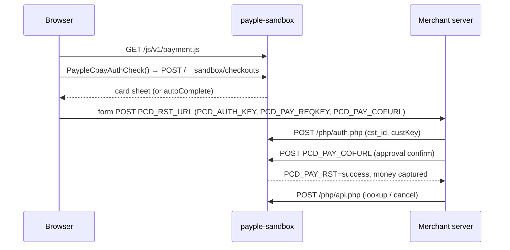

<div align="center">

# payple-sandbox

**A local [Payple](https://www.payple.kr) app-card sandbox for development, end-to-end tests and AI agents.**

Run real checkout flows — approve, decline, refund, time out — without a Payple account, a registered origin or a single won.

[](https://github.com/PeraSite/payple-sandbox/actions/workflows/ci.yml)
[](LICENSE)
[](https://bun.sh)
[](tsconfig.json)
[](package.json)

[Quick start](#quick-start) · [Control API](#control-api) · [Scenarios](#scenarios) · [Library usage](#library-usage) · [한국어](#한국어)

</div>

---

## Why

Payple's TEST environment is great for proving the real integration, but it is awkward for day-to-day work:

- every merchant origin must be registered first, so preview URLs and `localhost` fail with `AUTH0007`;
- someone has to click through a real card window for every run;
- failure paths — lost callbacks, approval timeouts, amount mismatches, cancellation errors — are nearly impossible to trigger on demand;
- TEST only supports full refunds, so partial-refund logic goes untested.

`payple-sandbox` speaks the same wire contract on your machine and adds a small HTTP control API, so humans, Playwright and coding agents can drive every path deterministically.

> [!IMPORTANT]
> This is an independent, community-made test double. It is **not affiliated with or endorsed by Payple**, and it is not a substitute for testing against Payple TEST before going live.

## Features

- 🧾 **Wire-compatible** — partner auth (`/php/auth.php`), CERT approval confirm, single and paginated list lookup, cumulative partial cancellation (`/php/api.php`).
- 🪟 **Hosted checkout window** — serves `/js/v1/payment.js` with `PaypleCpayAuthCheck()`, renders a mobile-friendly card sheet and form-POSTs the result to your `PCD_RST_URL`.
- 🤖 **Agent-friendly** — auto-approve checkouts, deliver callbacks server-to-server, or capture money with no callback at all; stable `data-testid`s on every button.
- 💥 **Failure injection** — approval timeout (money captured, response lost), amount mismatch, rejections, 5xx lookups, cancel failures, unavailable checkout script.
- 💾 **Persistent state** — optional JSON state file, so refunds still work after a restart.
- 📦 **Zero runtime dependencies** — one Bun process, also usable in-process as a `fetch` handler in your tests.

## Quick start

```sh
bunx github:PeraSite/payple-sandbox --app-origin http://localhost:3000
```

or from a clone:

```sh
git clone https://github.com/PeraSite/payple-sandbox && cd payple-sandbox
bun install
bun start -- --app-origin http://localhost:3000 --state .state/payple.json
```

or with Docker:

```sh
docker build -t payple-sandbox https://github.com/PeraSite/payple-sandbox.git
docker run --rm -p 9444:9444 payple-sandbox --app-origin http://localhost:3000
```

The server prints the merchant settings to plug into your app:

```text
Merchant settings:
  cst_id          sandbox
  custKey         sandbox-cust-key
  clientKey       sandbox-client-key
  refundKey       sandbox-refund-key
  API base        http://localhost:9444
  approval URL    http://localhost:9444/api/v1/payments/cards/approval/confirm
  checkout script http://localhost:9444/js/v1/payment.js
```

Point your Payple base URL, approval URL and checkout script at the sandbox — no code changes beyond configuration. A minimal merchant page lives in [`examples/checkout.html`](examples/checkout.html).

> [!TIP]
> If your app refuses non-HTTPS Payple URLs, put any TLS front in front of the sandbox (Caddy, `tailscale serve`, ngrok, [portless](https://github.com/vercel-labs/portless)…) and pass the public URL with `--origin`, or serve TLS directly with `--tls-cert` / `--tls-key`.

### Options

| Flag | Env | Default |
| --- | --- | --- |
| `-p, --port` | `PAYPLE_SANDBOX_PORT` | `9444` |
| `-o, --origin` | `PAYPLE_SANDBOX_ORIGIN` | `http://localhost:<port>` |
| `-a, --app-origin` (repeatable) | `PAYPLE_SANDBOX_APP_ORIGINS` (comma list) | `http://localhost:3000` |
| `-s, --state` | `PAYPLE_SANDBOX_STATE_FILE` | in memory |
| `--cst-id` · `--cust-key` · `--client-key` · `--refund-key` | `PAYPLE_SANDBOX_CST_ID` · `…_CUST_KEY` · `…_CLIENT_KEY` · `…_REFUND_KEY` | sandbox values above |
| `--tls-cert` · `--tls-key` | | plain HTTP |

## How a checkout flows



## Control API

All control routes live under `/__sandbox` and accept JSON.

| Request | Effect |
| --- | --- |
| `GET /__sandbox/state` | Payments (`pending` · `paid` · `declined` · `closed`, total, remaining balance) and the active scenario |
| `POST /__sandbox/scenario` | Merge scenario fields (unknown keys are ignored) |
| `POST /__sandbox/reset` | Clear payments and restore the default scenario |
| `POST /__sandbox/payments/:oid/complete` | Deliver the CERT callback server-to-server, exactly as the window would. Body: `{"result":"approve"\|"decline"\|"close"}`. Add `total` and `callbackUrl` for an order the browser never opened |
| `POST /__sandbox/payments/:oid/capture` | Mark the order paid **without** any callback — simulates a customer who closed the tab after paying |

```sh
# let the card window approve itself, then run your browser test
curl -X POST localhost:9444/__sandbox/scenario -d '{"autoComplete":"approve"}'

# the next approval captures money but answers after your timeout
curl -X POST localhost:9444/__sandbox/scenario -d '{"approvalConfirm":"timeout"}'

# what does Payple think happened?
curl localhost:9444/__sandbox/state
```

The checkout sheet exposes `payple-sandbox-approve`, `payple-sandbox-decline` and `payple-sandbox-close` test IDs for Playwright and browser agents.

## Scenarios

| Field | Values | What it simulates |
| --- | --- | --- |
| `autoComplete` | `null` · `approve` · `decline` · `close` | Show the card sheet, or settle it immediately |
| `approvalConfirm` | `ok` · `reject` · `timeout` · `amount_mismatch` · `server_error` | Card approval outcome; `timeout` captures money and replies after 12 s |
| `lookup` | `ok` · `server_error` | Payment lookup availability |
| `cancel` | `ok` · `reject` · `timeout` | Refund outcome; `timeout` refunds and replies late |
| `checkoutScript` | `ok` · `unavailable` | `/js/v1/payment.js` returns 503 |

Cancellations are cumulative like LIVE: list lookup reports `결제완료` → `부분승인취소완료` → `승인취소완료` with the remaining balance, and over-refunds are rejected.

## Library usage

`createPaypleSandbox()` returns a standard `fetch` handler, so you can run it in-process in unit tests — no ports, no network:

```ts
import { createPaypleSandbox } from "payple-sandbox";

const sandbox = createPaypleSandbox({
  origin: "https://payple.test",
  appOrigins: ["https://shop.test"],
  credentials: { cstId: "shop", custKey: "cust", clientKey: "client", refundKey: "refund" },
  fetch: myCallbackHandler,  // receives the CERT callback form POSTs
  timeoutDelayMs: 50,        // make `timeout` scenarios fast in tests
});

const paypleClient = createMyPaypleClient({
  baseUrl: "https://payple.test",
  fetch: (input, init) => sandbox.handle(new Request(input, init)),
});
```

Or serve it yourself: `Bun.serve({ fetch: sandbox.handle })`.

## Scope

Covered: domestic app-card **CERT** payments (one-off card payments with merchant-side approval). Not covered yet: billing keys / `PUSERINFO`, simple-pay `PAYM`, bank transfer, overseas cards, webhooks, cash receipts. Contributions welcome — please include a test that pins the wire shape.

## Development

```sh
bun install
bun test          # contract tests
bun run lint      # Biome
bun run typecheck
bun run dev       # watch mode
```

## 한국어

`payple-sandbox`는 [페이플](https://www.payple.kr) 국내 앱카드(CERT) 결제를 내 컴퓨터에서 흉내 내는 테스트 서버예요. 페이플 계정, 도메인 등록, 실제 결제 없이 결제·거절·부분 환불·승인 지연·콜백 유실을 마음대로 재현할 수 있어서, 개발자와 E2E 테스트와 AI 에이전트가 결제 흐름을 끝까지 직접 돌려볼 수 있어요. 페이플과 무관한 비공식 프로젝트이며, 실서비스 전에는 꼭 페이플 TEST 환경에서도 확인하세요.

## License

[MIT](LICENSE) © PeraSite
